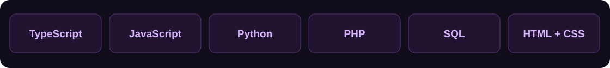

<h1 align="center">LCodes</h1>

<strong>Código com identidade. Ideias com vida.</strong> Produtos digitais · Automações · Experiências para web e desktop

<a href="https://pedinato.com">Pedinato</a> · <a href="https://solucaptcha.com">Solucaptcha</a> · <a href="https://github.com/luiz7filipe/LocalDrop">LocalDrop</a> · <a href="https://github.com/luiz7filipe/OasinsINC">OasinsINC</a>

---

### Por trás do avatar

Sou **LCodes**. Desenvolvo ferramentas para a operação de restaurantes, a organização da rotina e a comunicação entre dispositivos. O avatar e o universo roxo dão identidade a essa coleção de projetos.

Meu processo combina curiosidade, atenção ao produto e desenvolvimento com apoio de IA, incluindo Codex. Gosto de acompanhar uma ideia do primeiro protótipo até uma experiência que possa ser usada.

**O que me move:** construir, experimentar e melhorar.

 

### Tecnologias presentes nos meus projetos

**Interfaces:** React, Next.js, Vite, Tailwind CSS e PySide6/Qt  
**Aplicações e serviços:** Node.js, Express, Electron e ferramentas em Python  
**Dados e comunicação:** PostgreSQL, SQLite, Prisma, WebSocket e APIs HTTP

### Projetos em destaque

| Projeto | Proposta | Conheça |
| --- | --- | --- |
| **Pedinato** | Gestão para restaurantes: pedidos, mesas, caixa e cardápio digital | [Website](https://pedinato.com) |
| **Solucaptcha** | Plataforma de API, portal de conta e integrações | [Website](https://solucaptcha.com) · [Exemplos](https://github.com/luiz7filipe/solucaptcha-examples) |
| **LocalDrop** | Transferência de arquivos entre dispositivos na rede local | [Código aberto](https://github.com/luiz7filipe/LocalDrop) |
| **OasinsINC** | Aplicativo web para diário alimentar, calorias e rotina | [Repositório](https://github.com/luiz7filipe/OasinsINC) |

### Meu jeito de criar

- **Produto primeiro:** uma interface precisa ajudar alguém a realizar uma tarefa.
- **Identidade própria:** visual, interação e detalhes fazem parte do software.
- **Evolução contínua:** testar, aprender e voltar ao código.

<strong>Uma boa ideia merece sair do papel.</strong> <a href="https://github.com/luiz7filipe?tab=repositories">Explore meus repositórios ↗</a>

